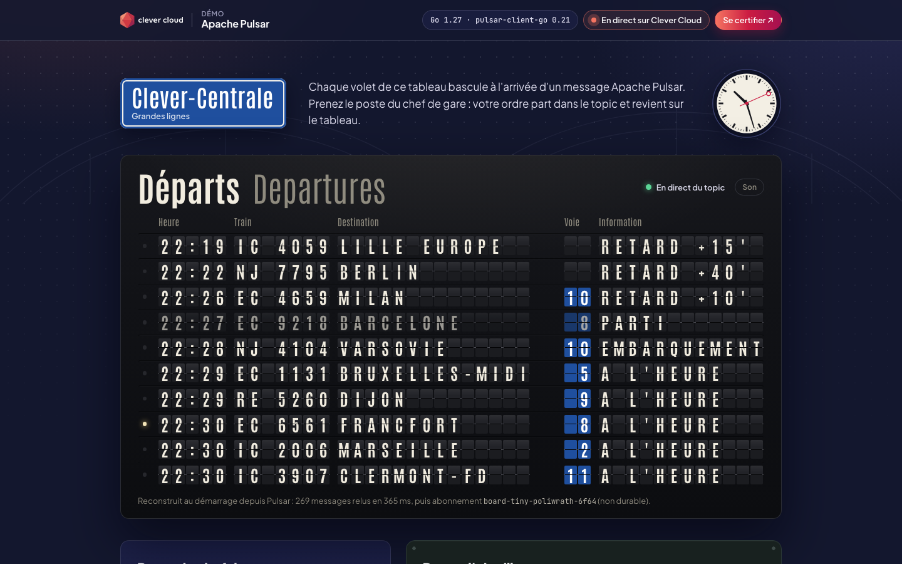
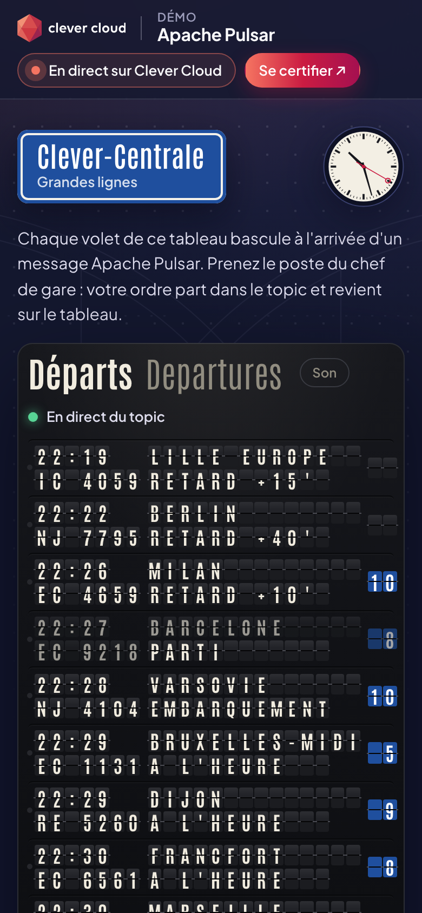

# Departures — Apache Pulsar on Clever Cloud

> A split-flap departures board, fed live by an Apache Pulsar topic. A simulated station clock announces trains, assigns platforms, starts boarding and dispatches departures; every one of those events is a Pulsar message, and every flap that turns on screen was read from the topic. Visitors take the station master's desk, delay or cancel a train, and watch their message travel producer → topic → subscription → board in a few milliseconds. A "late subscriber" replays the last 30 minutes from the topic and rebuilds the board from scratch. Go, one add-on, dressed in the Clever Brand Kit.





**Run it yourself.** The hosted demo was taken down after the presales review (November 2026). The steps in [Deploy on Clever Cloud](#deploy-on-clever-cloud) recreate it from scratch in about 10 minutes; the board fills up as the station clock announces trains.

---

## What Pulsar does here

```
station clock (simulator) ──┐                                         ┌──► board-<instance>   live board, pushed to browsers (SSE)
                            ├──► persistent://<tenant>/<ns>/departures ┼──► archives           durable, acknowledges every 45 s
station master (visitors) ──┘                                         └──► late-reader-…      replay on demand (reader)
```

| Piece | Pulsar feature | Where |
|---|---|---|
| Two producers on one topic | the clock and the visitors publish JSON events keyed by train id (same key, same order) | `pulsar.go` `send` |
| Live board | non-durable `Exclusive` subscription per instance; latency = receive time − publish time | `pulsar.go` `Follow` |
| Rebuild on start | a reader seeks 2 hours back (`SeekByTime`) and replays the topic: after `clever restart` the board comes back identical | `pulsar.go` `Replay` |
| Backlog you can see | the durable `archives` subscription acknowledges in batches, so its backlog grows and drains on the signal box | `pulsar.go` `Archive` |
| Late subscriber | a reader replays the last 30 minutes; the server folds it into 40 board frames played as a time-lapse | `app.go` `handleReplay` |
| One station clock, even with 2 instances | the clock runs only on the instance holding the `WaitForExclusive` producer of the `station-clock` topic; the other waits and takes over | `pulsar.go` `Lead` |
| Retention | the app sets the namespace retention to 24 h / 256 MB through the admin REST API, so the day can be replayed | `pulsar.go` `EnsureRetention` |
| Signal box stats | message counter, storage and per-subscription backlog from the admin REST API (`partitioned-stats`) | `pulsar.go` `Stats` |

The board state is "the newest version of each train": every event carries the full row and its timestamp, so replays and duplicates are harmless (`station.go` `Board.Apply`).

---

## Deploy on Clever Cloud

You need [clever-tools](https://www.clever.cloud/developers/doc/cli/) (`clever login` done) and the ID of the organisation that will own the resources (`orga_…`, shown in the Console). Run the commands from the repo root: `clever create` links the folder to the new app.

```bash
# 1. The app and its size
clever create --type go demo-pulsar --org <org_id> --region par
clever scale --min-flavor nano --max-flavor XS --min-instances 1 --max-instances 2
clever scale --build-flavor M

# 2. Pulsar (plan beta, the only one: shared, billed by usage; the provider offers no encryption option), linked to the app
clever addon create addon-pulsar demo-pulsar-station --plan beta --region par --org <org_id>
clever service link-addon demo-pulsar-station

# 3. Variables
clever env set CC_GO_BUILD_TOOL gomod
clever env set CC_HEALTH_CHECK_PATH /health

# 4. Deploy
clever deploy
clever open
```

There is no secret to generate and no setup script: the linked add-on injects the `ADDON_PULSAR_*` variables below, the topics `departures` and `station-clock` are created on first use, and the app sets the namespace retention itself at startup. `GET /health/deep` checks the broker and the admin API.

### Variables

| Variable | Set by | Used for |
|---|---|---|
| `ADDON_PULSAR_BINARY_URL` | Pulsar add-on | `pulsar+ssl://` broker URL for producers, consumers and readers |
| `ADDON_PULSAR_TOKEN` | Pulsar add-on | Biscuit token, sent as a token on the binary protocol and as `Bearer` on the admin API |
| `ADDON_PULSAR_TENANT` | Pulsar add-on | tenant (your organisation id) |
| `ADDON_PULSAR_NAMESPACE` | Pulsar add-on | namespace (the add-on id): topics live in `persistent://<tenant>/<namespace>/…` |
| `ADDON_PULSAR_HTTP_URL` | Pulsar add-on | admin REST API: topic stats, retention policy |
| `CC_GO_BUILD_TOOL` | you | `gomod`: build the module from `go.mod` |
| `CC_HEALTH_CHECK_PATH` | you | `/health`: deployment validated without touching the add-on |
| `PORT` | Clever Cloud | 8080 |

The add-on variables are read directly from the environment, never copied into other variables. The token never leaves the server.

Platform variables shown in the "Running on Clever Cloud" panel: `CC_APP_NAME`, `APP_ID`, `INSTANCE_NUMBER`, `INSTANCE_TYPE`, `CC_PRETTY_INSTANCE_NAME`, `CC_COMMIT_ID` (short), `CC_DEPLOYMENT_ID`.

### Cost

The `beta` plan is shared and billed by usage (price list of the `par` zone): the first 512 MB of throughput in and out, and the first 256 MB of storage, are free; beyond that, 0.80 € per GB of throughput (decreasing with volume) and about 0.20 € per GB-month of storage. This demo publishes a few hundred bytes every few seconds and keeps 24 h of history: it stays around the free tier.

---

## Routes

| Route | What it does |
|---|---|
| `GET /` | the board |
| `GET /api/stream` | Server-Sent Events: `hello` (snapshot), `msg` (each message read by the board subscription), `tick` (stats every 5 s) |
| `GET /api/board` | the same snapshot as JSON: rows, last messages with ids and latencies, subscription stats |
| `POST /api/orders` | station master: `{"train":"<id>","action":"delay","minutes":5\|10\|15}`, `"platform"` with `"platform":"1".."12"`, or `"cancel"`; returns the broker receipt (message id, ack time). One order every 2 s per visitor |
| `GET /api/replay` | late subscriber: reads the last 30 minutes with a reader, returns frames (shared for 20 s) |
| `GET /health` | 200, does not touch Pulsar |
| `GET /health/deep` | broker lookup on the binary protocol + admin API call |

---

## Local development

```bash
# with a Pulsar add-on: export the ADDON_PULSAR_* variables (see .env.example), then
PORT=8410 go run .
# tests (no Pulsar needed: a fake bus stands in)
gofmt -l . ; go vet ./... && go test -race ./...
```

Without `ADDON_PULSAR_BINARY_URL` the page still serves and says that no add-on is linked. Requires Go 1.27+.

## Project structure

```
main.go        → configuration, wiring of the three Pulsar loops, station clock loop, HTTP server
station.go     → trains, events, the board (fold of events), the simulator, the station master's rules, replay frames
pulsar.go      → everything that talks to Pulsar: producers, subscriptions, reader, exclusive-producer lock, admin REST API
app.go         → HTTP handlers, Server-Sent Events hub, rate limiter
main_test.go   → board, simulator, orders, replay frames, HTTP routes (fake bus)
static/        → index.html (template), app.js (flaps, clock, signal box, replay), app.css, Clever Brand Kit files (copied as is)
```

`static/` is embedded with `//go:embed`: the binary is self-contained.

## License

MIT, see [LICENSE](LICENSE).
